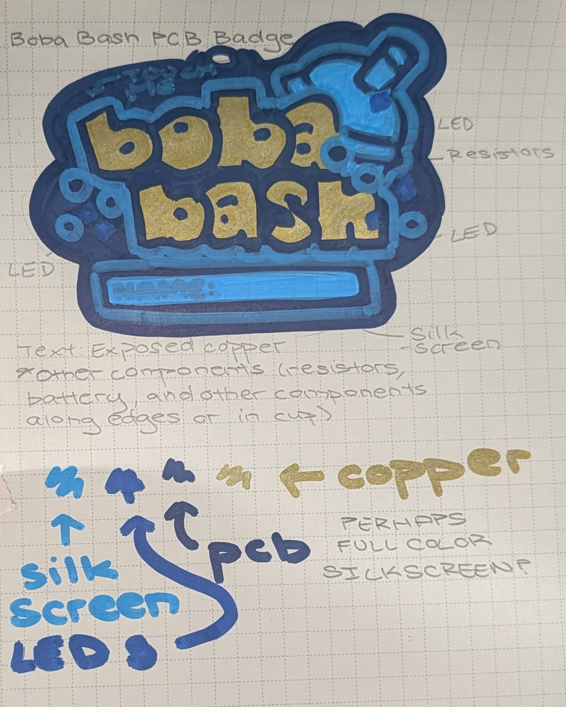
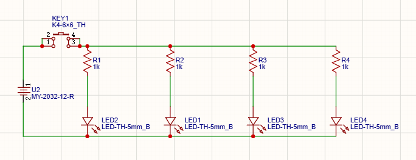
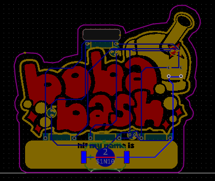
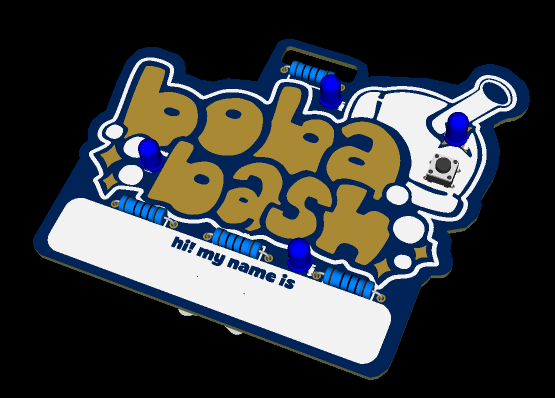
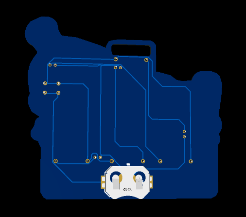

# Boba-Bash-Badge
This PCB badge is a custom light-up PCB with some cool silkscreen art and exposed copper art! I made this as a name badge for Boba Bash Peninsula, an event I have the opportunity of hosting under Hack Club! If you're a teen aged 13-18, RSVP for a Boba Bash near you: https://bash.hackclub.com/events
## Bill of Materials
* 4x 1KΩ Resistor
* 4x 5mm LEDs
* 1x 6x6mm Push Button
* 1x CR2032 Coin Battery
* 1x MY-2032-12-R-SMD Coin Battery Holder
## Sketches
I drafted a layout of the Boba Bash logo, a space for participant names, and indicated (generally) where I wanted electronic components to go. The original plan was to create an exposed copper ground pour that, when touched, would complete the circuit and light up LEDs! Because of time constraints, though, I didn't get to do this.
 
 

## Schematic
For creating the schematic itself, I wired the LEDs in parallel and added a button to the circuit so that the badge could be more interactive. The LEDs are powered by a 3V battery.
 
 

## PCB Layout
The components are all laid out on the front of the PCB and wired from the back, except for the battery holder which is wired from both front and back. I first added the silkscreen art (yellow) for details, outlines, and the name space before adding copper art (red) for text and sparkles. I struggled messing around with the exposed copper, as it interfered with some of the wiring, but after moving the resistors to the front of the PCB, all of my problems were solved.
 
 

## 3D View
I spent most of my time working on art, mapping, and figuring out how the final product would look, so overall, I'm very happy with the outcome. The vector art was very tedious to make, so I'm satisfied with how it looks on the board. I'm looking forward to handing these out at Boba Bash! :)
 
 

### Total Time Spent: I don't know! I worked on this over a span of 4 days, but I'd say around ~10-15 hours if you count making the vector art/design.
